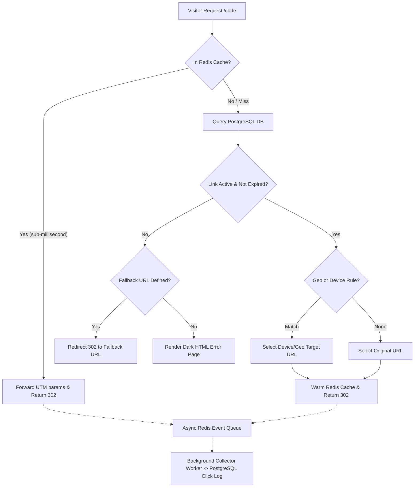

# UltraFast Link Shortener & Telemetry Engine

Welcome to the **UltraFast Link Shortener**, an enterprise-grade URL redirection and click telemetry platform built with a **5-layer Clean Layered Architecture** in Go.

It is designed to handle high-concurrency traffic with a **sub-10ms redirection SLA** using in-memory Redis caching, while asynchronously recording rich visitor telemetry into PostgreSQL.

---

## ⚡ Key Highlights

- **Sub-10ms Redirection**: Direct Redis cache lookup evaluates incoming requests and responds immediately with `HTTP 302 Found`.
- **Smart Device Routing**: Detects iOS, Android, and Desktop user agents, redirecting visitors to their native app store or app URL.
- **Geo-Location Targeting**: Directs visitors to country-specific landing pages (e.g. `ID` &rarr; Indonesian site, `US` &rarr; Global site) using Cloudflare headers.
- **Custom Fallback URLs**: Automatically routes visitors to an alternative URL when links expire or reach click quotas, eliminating broken links.
- **Multi-Platform Webhooks**: Automatically dispatches alerts to **Discord** (rich embeds), **Slack** (Block Kit), **Telegram** (bot messages), or custom HTTP endpoints upon reaching click milestones.
- **Observability**: Built-in Prometheus metrics at `/metrics` with p95/p99 latency histograms and Swagger OpenAPI documentation at `/swagger/index.html`.

---

## 🏗️ Architecture Overview

The backend is built as a **Modular Monolith** divided into distinct domain packages:

```
app/modules/
├── auth/        # User management, JWT token issuance & API Keys
├── link/        # Shortlink CRUD, Base62 code generation & QR generator
├── redirect/    # Ultra-fast cache lookup, device/geo routing & fallback
├── analytics/   # Asynchronous queue worker, visitor demographics & CSV export
└── web/         # Astro Frontend static serving & dashboard
```

Each module strictly follows the **5-Layer Clean Architecture**:
1. `model.go` &mdash; Database schema and request/response DTOs
2. `repository.go` &mdash; Database queries via GORM (PostgreSQL)
3. `redis.go` &mdash; Redis cache lookup, invalidation & event queueing
4. `service.go` &mdash; Business logic, validation, and domain orchestration
5. `handler.go` & `route.go` &mdash; HTTP presentation layer powered by Echo v4

---

## 🔄 The Redirection Flow

When a visitor accesses `http://localhost:8080/{short_code}`:



---

## Next Steps

- Proceed to the [Quick Start Guide](/docs/getting-started/quick-start) to create your first shortlink.
- Check [Smart Device Routing](/docs/features/device-routing) to configure iOS and Android app redirects.
- Explore the [API Reference](/docs/reference/api-reference) for programmatic integration.
